# Converse and Reconverse

Reconverse is the rewrite of Converse, the machine-independent layer under Charm++, that Charm++ 9.0 is built on. It keeps the Converse programming interface that Charm++, AMPI and standalone Converse programs use, and replaces everything under that interface: the machine layers give way to the LCI communication library behind a small backend interface, the comm thread is gone, and the scheduler, queues and startup are new code.

Written 2026-10-19 to answer how the two differ. Facts were read from the trees on 2026-10-19: reconverse at `b23a7fb`, Charm++ `recharm` at `30be41e21` (tag `v9.0.0-alpha2` is at `247c38f98`), and the pending classic-deletion branch (charm #4061). Line counts come in two forms: "lines" is `wc -l` over `git ls-files`; "code" excludes blank lines and comments (a simple C/C++ comment stripper over the same files). Comment density is similar on both sides: classic is 74% code, reconverse 69%.

## The short version

- **Same interface above.** Charm++ programs run on reconverse unchanged. The Converse API (`Cmi*`, `Cth*`, `Ccd*`, `Cld*`, `Csd*`, CCS, persistent channels, the zero-copy Ncpy calls) is the same family of calls, with about 210 rarely used classic entry points dropped (section 5).
- **LCI instead of machine layers.** Classic Converse carried nine network layers (netlrts, mpi, ucx, verbs, ofi, gni, pami, pamilrts, multicore) plus 17,000 lines of shared machine code. Reconverse has a backend interface of 42 code lines with one production implementation on LCI and one on MPI through LCW. Network portability (OFI, ibverbs, UCX, shared memory) is LCI's job.
- **No comm thread, no charmrun.** Every PE is a worker thread that also polls the network from its scheduler loop. Programs are launched directly with `lcrun`, `srun` or `mpirun` and sized with `+pe`.
- **Rewritten core, ported periphery.** Startup, scheduler, queues, the backend layer, collectives, RDMA and shared-memory IPC are new. Threads, conditions and timers, seed balancing, mempool, affinity, topology, persistent channels, CCS and the message manager were ported file by file from classic. Nothing was copied wholesale, so classic's dead code did not come along.
- **Smaller.** Counting only code the project wrote (no comments, no blank lines, no vendored third-party files): 12,900 lines of reconverse against 66,800 for classic's conv-core, conv-ldb and arch, plus 5,100 for charmrun. With vendored code included, 21,600 against 97,200. Section 4 has the breakdown.
- **Two things AMPI needs are not there yet:** isomalloc and migratable threads. They were left out of the rewrite and return as the next two AMPI stages (section 6).

## 1. Block diagram: modules and interfaces

Read top to bottom. Each box names a module, its source file and its code lines (blank lines and comments excluded). The labels on the arrows are the interfaces that cross each boundary.

```mermaid
flowchart TB
  subgraph P["Programs (unchanged between classic and reconverse)"]
    direction LR
    P1["Charm++ applications<br/>chares, arrays, SDAG, groups"]
    P2["AMPI programs<br/>stage 0: builds and runs, no migration"]
    P3["Standalone Converse programs<br/>e.g. the Argobots-style shim for Mochi"]
  end
  subgraph C["Charm++ runtime (charmplusplus/charm, branch recharm; reconverse is the submodule contrib/reconverse)"]
    direction LR
    C1["ck-core<br/>init.C, ck.C, ckarray, ckreduction, location manager"]
    C2["Load balancing<br/>ck-ldb: TreeLB, strategies, LB database"]
    C3["Libraries<br/>TCharm, AMPI, CCS (liveViz), TRAM via htram, GPU (hapi)"]
    C4["reconverse-compat shim<br/>tcharm/reconverse-compat, 273 lines: stubs CthMigratable, CthCreateMigratable, conv-config.h"]
    C5["Tracing and replay<br/>ck-perf: Projections, record-replay"]
  end
  subgraph R["Reconverse (charmplusplus/reconverse, src/ + include/: 66 files, 15,627 code lines)"]
    direction LR
    R1["Startup and PE threads<br/>convcore.cpp (1,519): ConverseInit, +pe parsing, one pthread per PE, sends, CmiAbort"]
    R2["Scheduler<br/>scheduler*.cpp (762): registered pollable sources in a slot table; +old-scheduler, +randomized_msgq"]
    R3["Queues<br/>queue.h, queueing.cpp (Cqs priority queue), concurrentqueue.h (moodycamel MPMC)"]
    R4["Threads (Cth)<br/>threads.cpp (415) on boost fcontext; no migration"]
    R5["Conditions and timers (Ccd)<br/>conv-conds.cpp (187)"]
    R6["Seed balancing (Cld)<br/>cldb.cpp, cldb.rand.cpp (187)"]
    R7["Collectives<br/>collectives.cpp (592): broadcast, node broadcast, spanning tree, CmiReduce"]
    R8["Zero-copy RDMA<br/>conv-rdma.cpp, cmirdmautils.cpp (609): Ncpy get/put, registration"]
    R9["Persistent channels<br/>persist-comm.cpp (517)"]
    R10["Shared-memory IPC<br/>cmishmem.cpp + shm/xpmem (955): +ipc pool between processes on one host"]
    R11["Topology and affinity<br/>conv-topology.cpp, cpuaffinity.cpp (1,083): hosts by IP, +setcpuaffinity, +pemap"]
    R12["CCS server<br/>src/ccs (1,797): PE 0 hosts the socket; libccs-client"]
    R13["Mempool<br/>mempool.C and .h (602): registered-memory pool for the backend"]
    R14["Message manager, task queue, random<br/>msgmgr.cpp, conv-taskq.cpp, random.cpp"]
  end
  subgraph B["Communication backends (src/comm_backend; chosen at run time with +backend, default lci)"]
    direction LR
    B1["lci2<br/>525 code lines. Default. LCI 2 active messages and RMA"]
    B2["lcw<br/>284 code lines. LCW wrapper, MPI underneath by default"]
    B3["none<br/>single process, no launcher: backend skipped"]
  end
  subgraph N["Network and launch (outside reconverse)"]
    direction LR
    N1["LCI<br/>uiuc-hpc/lci, pinned in CMakeLists.txt; backends: OFI (libfabric), ibverbs, UCX; shared memory"]
    N2["Process management<br/>LCT PMI: PMI1, PMI2, PMIx, MPI, or a file on shared storage"]
    N3["Launchers<br/>lcrun (ships with LCI), srun --mpi=pmi2 or pmix, mpirun"]
  end
  P -->|"Charm++ API (charm++.h, ckarray, ckreduction, ...)"| C
  C -->|"Converse API: converse.h (263 functions), conv-rdma.h, persistent.h, conv-ccs.h"| R
  R -->|"comm_backend.h (42 code lines): init, issueAm, issueRget / issueRput, registerMemory, progress, barrier, malloc"| B
  B -->|"LCI API, MPI"| N
```

What is deliberately not in the picture: no comm thread (progress is a call in every PE's scheduler loop), no charmrun process (CCS and process start-up both assume there is none), and no LRTS layer. The backend interface above plays LRTS's role, at a fraction of its size; a handful of `Lrts*`-named functions survive only inside the topology code.

## 2. Classic Converse versus reconverse

| Area | Classic Converse (branch classic, Charm++ 8.1) | Reconverse (Charm++ 9.0 line) |
|---|---|---|
| Code base | 97,200 code lines: arch 44,500, conv-core 26,400, QuickThreads 22,000, conv-ldb 4,300; charmrun 5,100 more. Grown since 1996. | 15,600 code lines in src and include, first commit 2024-12-16, 347 commits to date. Core rewritten, periphery ported. |
| Network | Machine layers under LRTS: netlrts, mpi, ucx, verbs, ofi, gni, pami, pamilrts, multicore, each with its own progress and memory registration code. | One backend interface (comm_backend.h); LCI 2 is the production backend, LCW/MPI the alternative. OFI, ibverbs, UCX and shared memory are LCI's backends. |
| Process model | Non-SMP: one process per PE. SMP: worker PEs plus one comm thread per process that owns the network. | Always one process with N PE threads. No comm thread. The network is polled from each PE's scheduler loop. |
| Launch and sizing | `./charmrun ++local ./app +p8 ++ppn 4`. charmrun starts processes and relays CCS and stdio. `+p` is the total PE count. | `./app +pe 4` (one process) or `lcrun -n 2 ./app +pe 8`, `srun --mpi=pmi2 -n 2 ./app +pe 8`, `mpirun -n 2 ./app +backend lcw +pe 8`. `+pe` is the total across processes; `+ppn` and `+p` are per process. |
| Scheduler | One hard-coded loop in convcore.C polling a fixed set of queues and the machine layer. | Pollable sources register a handler in a slot table (scheduler_registered.cpp). The original loop is kept behind `+old-scheduler`; `+randomized_msgq` delivers in random order for testing. |
| User-level threads | Cth on QuickThreads or uFcontext/uJcontext; migratable threads with isomalloc stacks, CthPup. | Cth on boost fcontext (vendored boost-context, 6,000 code lines of assembly and headers). Same create/suspend/awaken/yield API. No migration: the migratable flag is accepted and ignored. |
| Isomalloc | isomalloc.C (2,174 code lines) and memory-isomalloc.C: address-space partition across processes, migratable stacks and heaps. | Absent. Only the `CMI_MEMORY_IS_ISOMALLOC` flag constant exists. Returns in AMPI stage 1. |
| Memory | CmiAlloc with pluggable memory modules (gnu malloc, paranoid, isomalloc, ...); CmiMemoryUsage reports real figures. | CmiAlloc and CmiFree present; messages come from the backend's registered mempool. `CmiMemoryUsage` is a stub returning 0. `+glibc_tuned_malloc` tunes glibc instead. |
| Zero-copy and persistent | Ncpy get/put, device zero-copy, persistent channels, all machine-layer specific. | Same APIs (conv-rdma.h, persistent.h) on the backend's registerMemory, issueRget and issueRput. |
| Same-host IPC | PXSHM and XPMEM inside the machine layers (netlrts, verbs, gni). | A Converse-level pool, `+ipc`, with shm and xpmem transports, usable by any backend. |
| Collectives | Spanning-tree broadcast and reductions in the machine-common code; CmiReduce with ID, struct and pup variants. | Spanning-tree broadcast, node broadcast, CmiReduce and CmiNodeReduce with merge functions only. Backend provides a barrier and nothing else. |
| Seed balancing (Cld) | Many strategies in conv-ldb (rand, neighbor, workstealing, spray, ...). | rand and none; the Cld API is unchanged. Further strategies are a planned re-port (reconverse #185). |
| Topology and affinity | Hostname exchange through charmrun; hwloc-based affinity. | Hosts identified by IP address, exchanged over the network; same `+setcpuaffinity` and `+pemap` options. |
| CCS | charmrun hosts the server socket and forwards requests. | PE 0 hosts the socket; same CcsRegisterHandler and client library. |
| Checkpoint and restart | Disk checkpoint, in-memory checkpoint with restart-phase hooks in converse.h. | Disk checkpoint through Charm++ unchanged (tests/charm++/chkpt passes in the Mac sweep). The converse-side in-memory checkpoint hooks are absent. |
| Tracing and replay | Projections tracing, record-replay. | Both work. Recording on reconverse needs per-record flushing (`+recplay-logsize`). |
| GPUs | hapi, device zero-copy in the cuda arch overlay. | Same, through reconverse-linux-x86_64-cuda; GPU-aware load balancing merged 2026-09. |
| Interoperability | MPI interop, user-driven interop. | User-driven interop added 2026-10-19 (reconverse #288, charm #4055). MPI interop absent on the Converse side; slated to return. |
| AMPI | Full, with thread migration and isomalloc-based privatization. | Stage 0 (charm #4051, 2026-10-19): builds and runs, non-migrating; migration and checkpoint tests skipped. |
| Abort | charmrun kills the job on CmiAbort; stack trace printed. | CmiAbort aborts the local process; with the srun or lcrun launchers other ranks could survive (reconverse #285). Fixes in flight: LCT_pmi_abort (uiuc-hpc/lci #209) plus a backend abortAll call; stack traces on abort and fatal signals in reconverse #294. |
| Build | ./build with the classic configure, or CMake. | CMake only (`./build charm++ reconverse-linux-x86_64`); reconverse builds as a shared library with its own CMake project and fetches or finds LCI. |

**One sizing surprise.** In classic, `+p8` means eight PEs in total. In reconverse, `+p8` means eight PEs per process (the comment in convcore.cpp says it is kept "for backward compatibility with Converse", but Converse's `+p` was a total). For a single process the two agree, which is why it goes unnoticed; under `lcrun -n 2` they differ by a factor of two. Worth settling before 9.0 (reconverse #296).

## 3. One tree, two runtimes: the current state

Until the classic-deletion pull request (charm #4061) merges, the `recharm` branch holds both runtimes and builds Charm++ against either one. The switch is a CMake option, `RECONVERSE`, and the Charm++ source carries 79 conditional lines in 31 files, 48 of them `#if CMK_RECONVERSE` or `if(RECONVERSE)`. The files with the most are CMakeLists.txt (17) and cmake/converse.cmake (7); everything else has three lines or fewer. That is the whole cost of supporting both, and it is what "a few ifdefs" means.

The deletion removes classic Converse from `recharm`: 705 files, 155,529 lines, including src/conv-core except eleven headers, src/arch, conv-ldb, QuickThreads and charmrun. The classic line stays on the `classic` branch (Charm++ 8.1.0) and in every tag up to `v9.0.0-alpha2`, so the two-runtime tree remains checkable for comparison.

## 4. Sizes

| Classic component | files | lines | code |
|---|---:|---:|---:|
| src/arch (machine layers) | 468 | 62,864 | 44,516 |
| &nbsp;&nbsp;of which arch/util (shared) | 44 | 17,417 | 11,848 |
| &nbsp;&nbsp;verbs / gni / netlrts / ofi | | 7,935 / 6,075 / 4,520 / 4,218 | 5,436 / 5,023 / 3,092 / 2,993 |
| &nbsp;&nbsp;mpi / pami / pamilrts / ucx | | 3,140 / 2,361 / 2,053 / 1,728 | 2,424 / 1,779 / 1,586 / 1,366 |
| src/conv-core | 74 | 37,414 | 26,409 |
| src/QuickThreads | 103 | 25,213 | 21,971 |
| src/conv-ldb | 18 | 5,334 | 4,265 |
| charmrun | 5 | 6,378 | 5,135 |
| Total (without charmrun) | 663 | 130,825 | 97,161 |

| Reconverse component | files | lines | code |
|---|---:|---:|---:|
| src + include | 66 | 22,547 | 15,627 |
| &nbsp;&nbsp;convcore.cpp | 1 | 2,105 | 1,519 |
| &nbsp;&nbsp;ccs/ | 6 | 2,484 | 1,797 |
| &nbsp;&nbsp;scheduler + queues | 11 | 5,506 | 3,839 |
| &nbsp;&nbsp;&nbsp;&nbsp;of which concurrentqueue.h (third party) | 1 | 3,747 | 2,719 |
| &nbsp;&nbsp;comm_backend (interface, lci2, lcw) | 10 | 1,406 | 1,066 |
| &nbsp;&nbsp;converse.h | 1 | 1,616 (classic 2,346) | 1,114 (classic 1,708) |
| boost-context (vendored) | 97 | 11,312 | 5,984 |
| Commits (non-merge) since 2024-12-16 | | 347 | |

### Vendored third-party code

Both trees carry code they did not write. It is counted above and separated here, so the "own code" line is the fair comparison.

| Vendored component | files | lines | code |
|---|---:|---:|---:|
| Classic: QuickThreads (U. Washington, 1993; modified by PPL) | 103 | 25,213 | 21,971 |
| Classic: memory-gnu (glibc ptmalloc, conv-core) | 3 | 7,879 | 4,739 |
| Classic: lz4 (arch/util) | 2 | 3,613 | 2,138 |
| Classic: simple_pmi (from MPICH, arch/util) | 8 | 2,572 | 1,474 |
| Classic vendored total | 116 | 39,277 | 30,322 |
| Classic own code (97,161 minus vendored) | | | 66,839 |
| Reconverse: concurrentqueue.h (moodycamel, in src) | 1 | 3,747 | 2,719 |
| Reconverse: boost-context (outside src, not in the 15,627) | 97 | 11,312 | 5,984 |
| Reconverse vendored total | 98 | 15,059 | 8,703 |
| Reconverse own code (15,627 minus concurrentqueue.h) | | | 12,908 |

Own code, classic to reconverse: 66,839 to 12,908, a factor of 5.2. QuickThreads is listed as vendored because its origin is external, although PPL modified it heavily over the years. hwloc, LCI and LCW live outside both trees and are not counted on either side.

Authors by commit count: Ritvik Rao 200, Maya Taylor 75, Jiakun Yan 49, Laxmikant Kale 29, Steven Qie 19, Zane Fink 11, Aditya Bhosale 11, Kavitha Chandrasekar 7.

## 5. API compatibility

reconverse's converse.h declares 263 functions: 177 `Cmi*` (including 11 `CmiIpc*`), 23 `Cth*`, 10 `Ccd*`, 10 `Cld*`, 5 `Csd*`, 7 `Cmm*`, plus the `Cpv/Ctv/Csv` macro family, the 19 Ncpy calls in conv-rdma.h, 12 persistent-channel calls and the Ccs API. Everything Charm++'s core uses is present under its classic name.

About 210 identifiers from classic's converse.h have no counterpart. The ones a library author might notice:

- Thread migration: `CthPup`, `CthMigratable`, `CthCreateMigratable`, `CmiIsomalloc*` (returning; the TCharm shim stubs them meanwhile).
- Asynchronous sends: the whole `CmiAsync*` family and `CmiReleaseCommHandle`; `CmiSyncVectorSend`; `CmiMultipleSend`.
- Reductions: `CmiReduceID`, `CmiReduceStruct`, the pup and delete variants. Only `CmiReduce` and `CmiNodeReduce` with a merge function remain.
- Idle and comm-thread notification: `CmiNotifyIdle`, `CmiNotifyCommThd*`; use `CcdCallOnCondition(CcdPROCESSOR_STILL_IDLE, ...)`.
- Conditions: `CcdCallOnConditionOnPE`, `CcdSetResolution`.
- Memory and debugging: `CmiMemoryMark/Sweep/Check`, `CmiMemoryAtomic*`, `CmiAlignedAlloc`, `CmiPoolAlloc`, `CmiBacktrace*`, `CmiHwlocTopology`; `CmiMemoryUsage` exists but returns 0.
- Handlers: `CmiRegisterHandlerLocal` and `CmiRegisterHandlerGlobal` (only `CmiRegisterHandler`).
- In-memory checkpoint hooks: `CmiGetRestartPhase` and the restart-phase message filter.

## 6. What comes back, what stays gone

### Returning

- **Isomalloc** (AMPI stage 1): the address-space partition agreed at startup, per-PE regions, and the allocator hook for stacks and, for AMPI, heaps. Classic isomalloc.C is the reference; the mmap arithmetic ports, the startup agreement uses reconverse collectives.
- **Migratable threads** (AMPI stage 2): CthPup over an isomalloc stack, then un-guarding migrate, async migrate and checkpoint in TCharm and AMPI, and switching tests/ampi migration and chkpt back on.
- **Seed balancers**: a re-port of the classic strategies as an opt-in (reconverse #185 plan).
- **Job-wide abort**: LCI #209 and the reconverse abortAll call, so CmiAbort ends every rank under srun and lcrun.
- **Stack traces** on CmiAbort and fatal signals, rewritten (reconverse #294), and **Converse futures** (Cfuture), ported (reconverse #295), both for standalone Converse programs and crash reports.
- **Interoperation with MPI programs** (CharmLibInit): decided 2026-10-20 to return; no date yet.

### Gone by decision

- **charmrun** and the comm-thread SMP model. Launch through the job's process manager; progress from the scheduler.
- **Machine layers and LRTS.** New networks are LCI backends.
- **QuickThreads.** boost fcontext is the one context switcher.
- **pose and mblock** libraries (removal is a follow-up to the deletion, charm #4056).
- **CmiAsync\*** sends and the struct/ID reduction variants, unless a user asks.

## 7. Timeline and where to read more

- **2024-12-16** first reconverse commit. **2026-09-14** announcement to users that the reconverse line becomes the main line. **2026-10-13** Charm++ 8.1.0, the last classic release; `main` renamed `classic`, `recharm` becomes the default branch. **2026-10-16** v9.0.0-alpha1. **2026-10-19** v9.0.0-alpha2; AMPI stage 0 and user-driven interop merged; classic-deletion PR #4061 opened.
- Repositories: [charmplusplus/reconverse](https://github.com/charmplusplus/reconverse) (README covers build options, backends, +ipc, +randomized_msgq, CCS, Delta recipes), [charmplusplus/charm](https://github.com/charmplusplus/charm) branch recharm, [uiuc-hpc/lci](https://github.com/uiuc-hpc/lci).
- Deeper notes on single slices: "IPC in the Reconverse Stack" (same-host communication, 2026-09-15) and "Reconverse Message Queues" (scheduler and queue internals, 2026-10-11), both internal notes.
- The Charm++ manual's Converse chapter still describes classic; this page is the current description until the manual is updated for 9.0.
